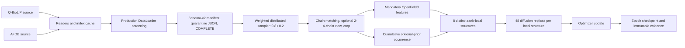
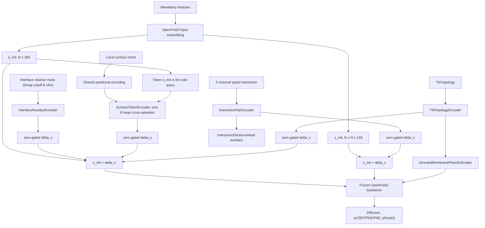

# PhysPPI：基于 OpenFold3 的蛋白质相互作用结构建模

PhysPPI 是构建在 [OpenFold3](https://github.com/aqlaboratory/openfold-3)
之上的蛋白质相互作用结构建模扩展。项目在保留 OpenFold3 mandatory
输入和 diffusion 主干的基础上，引入 interface residue、typed interaction、
surface mesh、TM topology、directed membrane geometry 和 pDockQ
assessment，并只训练 PhysPPI prior 相关模块。

本仓库在 `h20_jinyu` 上的 canonical checkout 是：

```text
/101045/jinyu/PhysPPI/openfold-3
```

## 项目定位

PhysPPI 的核心扩展包括：

- per-residue interface-residue conditioning（dmap 随机 cutoff 8~18Å）；
- five-channel typed interaction conditioning；
- token-to-mesh surface cross-attention；
- TM topology 和 directed membrane plane；
- frozen OpenFold3 backbone（LoRA 默认禁用）；
- Q-BioLiP/AFDB weighted sampling；
- production DataLoader screening、exact-ID quarantine 和可恢复训练。

## 目录

- [完整训练流程](#完整训练流程)
- [环境配置](#环境配置)
- [网络架构](#网络架构)
- [数据集与特征契约](#数据集与特征契约)
- [数据筛查](#数据筛查)
- [训练脚本](#训练脚本)
- [从头启动训练](#从头启动训练)
- [重要参数](#重要参数)
- [监控、错误处理与恢复](#监控错误处理与恢复)
- [输出与证据](#输出与证据)
- [OpenFold3 上游、许可与引用](#openfold3-上游许可与引用)
- [备份与恢复索引](#备份与恢复索引)

## 完整训练流程

环境检查 → 完整 20k 筛查 → schema-v2 manifest → smoke/formal YAML →
八卡 smoke → checkpoint 与 sampler parity 验证 → 50-epoch formal。

## 环境配置

### 固定路径

| 资源 | 路径 |
|---|---|
| canonical checkout | `/101045/jinyu/PhysPPI/openfold-3` |
| CUDA Pixi 环境 | `/101045/jinyu/PhysPPI/openfold-3/.pixi/envs/openfold3-cuda12` |
| OpenFold3 初始权重 | `/101045/jinyu/.openfold3/of3-p2-155k.pt` |
| Q-BioLiP | `/101045/jinyu/PPI/Prior_out/training/Q-BioLiP-10k-new` |
| AFDB | `/101045/jinyu/PPI/Prior_out/training/AFDB-10k-1` |
| CCD | `/101045/jinyu/PhysPPI/openfold-3/output/physppi_msa_cache/components.cif` |
| reader index cache | `/101045/jinyu/PhysPPI/runs/physppi_formal_8gpu/reader-index-cache` |
| run/evidence root | `/101045/jinyu/PhysPPI/runs` |

### 登录和健康检查

```bash
ssh h20_jinyu
cd /101045/jinyu/PhysPPI/openfold-3

git branch --show-current
git status --short
nvidia-smi

.pixi/envs/openfold3-cuda12/bin/python - <<'PY'
import torch
print("torch", torch.__version__)
print("cuda_available", torch.cuda.is_available())
print("cuda_devices", torch.cuda.device_count())
PY

.pixi/envs/openfold3-cuda12/bin/run_openfold --help

test -f /101045/jinyu/.openfold3/of3-p2-155k.pt
test -f /101045/jinyu/PhysPPI/openfold-3/output/physppi_msa_cache/components.cif
test -d /101045/jinyu/PPI/Prior_out/training/Q-BioLiP-10k-new
test -d /101045/jinyu/PPI/Prior_out/training/AFDB-10k-1
```

训练前代码检查：

```bash
.pixi/envs/openfold3-cuda12/bin/ruff check \
  openfold3/projects/of3_all_atom/physppi \
  openfold3/core/data/framework \
  openfold3/core/loss \
  openfold3/projects/of3_all_atom/model.py \
  scripts/physppi

.pixi/envs/openfold3-cuda12/bin/python -m pytest \
  openfold3/tests/projects/of3_all_atom/physppi/integration/test_end_to_end_prior_smoke.py \
  -q
```

新训练只能从 canonical checkout 启动。不要编辑 rollback checkout，不要从
历史 dirty worktree 启动训练，不要运行
`start_physppi_stage1_when_audits_ready.sh`，也不要停止 ownership
无法确认的 GPU 进程。

## 网络架构

### 数据到训练



数据源先按 Q-BioLiP `0.8`、AFDB `0.2` 随机选择，再在选中 source
内部均匀、有放回采样。每个同步 micro-step 的 8 个 rank 使用 8 个不同
`(dataset, sample_id)`；每张卡的 DataLoader batch size 为 1，该结构
只在本卡 diffusion 内扩展为 48 个具有独立增强和噪声的 replicas。

### Optional-prior 注入



interaction 只生成 pair residual `delta_z`；
interface residue、surface 和 TM 只生成 single residual `delta_s`。所有 PhysPPI residual gate 精确零初始化，optional
slot 缺失、inactive 或 invalid 时返回精确零，并且只在 input embedding 阶段注入一次。
continuous dmap 不进入网络；pEnergy 和 Delta-G 不属于该训练路线。
pDockQ 是唯一 PhysPPI-specific assessment；directed membrane normal 和反向 normal 不等价。

## 数据集与特征契约

### 数据源

- Q-BioLiP 10k 提供实验复合体和可用的 interaction、surface、TM 等 prior。
- AFDB 10k 提供 AFDB 来源结构及对应 PhysPPI prior 文件。
- 正式训练只读取新筛查生成的 eligible manifest，不直接把完整 source
  inventory 当作可训练清单。

### Mandatory OpenFold3 inputs

结构、序列、MSA/template 和合法 monomer geometry 属于 mandatory 输入。
任一 mandatory 输入缺失或 malformed 时样本不可训练。

### Cumulative optional priors

optional level 固定为：

| Level | Active prefix | Probability |
|---|---|---:|
| L0 | mandatory | 0.20 |
| L1 | mandatory + interface residue | 0.20 |
| L2 | L1 + interaction | 0.20 |
| L3 | L2 + surface | 0.20 |
| L4 | L3 + TM | 0.20 |

合法缺失允许 effective level 降级；malformed present slot 是 screening
failure，不能伪装为 missing。

### Labels 与泄漏边界

complex GT coordinates、interaction endpoint distance 和 directed membrane
plane 是 labels。数据处理可从 GT dmap 采样
`tau ~ Uniform(8,18 Angstrom)` 并生成 per-residue interface-residue mask，
但 continuous dmap 和采样阈值都不会成为模型输入。

### Surface mesh

训练集提供 mesh；mandatory-only inference 不依赖 mesh。每个 token 最多
选择 64 个同链 mesh 点，局部 frame 来自 owning residue 的 `N-CA-C`。
local coordinates 与 normals 使用同一 frame，六个属性顺序为
`[charge, hphob, nx, ny, nz, si]`。该 token 的 `s_init` 是唯一 query，
query 和 mesh key/value 共用 stateless positional basis。

## 数据筛查

正式训练前必须用 production DataLoader 重新筛查完整 20k source inventory：

```bash
cd /101045/jinyu/PhysPPI/openfold-3

RUN_VERSION=semantic-screen-$(date -u +%Y%m%dT%H%M%SZ)
AUDIT_ROOT=/101045/jinyu/PhysPPI/runs/physppi_semantic_50epoch/audits/${RUN_VERSION}
mkdir -p /101045/jinyu/PhysPPI/runs/physppi_semantic_50epoch/audits

CUDA_VISIBLE_DEVICES="" \
OMP_NUM_THREADS=1 \
MKL_NUM_THREADS=1 \
OPENBLAS_NUM_THREADS=1 \
nohup nice -n 19 ionice -c 3 \
  .pixi/envs/openfold3-cuda12/bin/python \
  scripts/physppi/screen_full_dataset.py \
  --qbiolip-root /101045/jinyu/PPI/Prior_out/training/Q-BioLiP-10k-new \
  --afdb-root /101045/jinyu/PPI/Prior_out/training/AFDB-10k-1 \
  --qbiolip-index-cache /101045/jinyu/PhysPPI/runs/physppi_formal_8gpu/reader-index-cache/qbiolip10k-v1.pkl \
  --afdb-index-cache /101045/jinyu/PhysPPI/runs/physppi_formal_8gpu/reader-index-cache/afdb10k-v1.pkl \
  --qbiolip-canonical-report /101045/jinyu/PhysPPI/runs/physppi_formal_8gpu/manifests/qbiolip-audit.json \
  --afdb-canonical-report /101045/jinyu/PhysPPI/runs/physppi_formal_8gpu/manifests/afdb-audit.json \
  --history-runs-root /101045/jinyu/PhysPPI/runs/physppi_formal_8gpu \
  --manifests-dir /101045/jinyu/PhysPPI/runs/physppi_formal_8gpu/manifests \
  --runtime-ledger /101045/jinyu/PhysPPI/runs/physppi_formal_8gpu/manifests/runtime-failure-ledger.jsonl \
  --prior-audit /101045/jinyu/PhysPPI/runs/physppi_formal_8gpu/audits/v1-v32-full-20k-data-errors/data-error-ids.json \
  --components-cif /101045/jinyu/PhysPPI/openfold-3/output/physppi_msa_cache/components.cif \
  --reference-molecule-directory /101045/jinyu/PhysPPI/openfold-3/openfold3/core/data/resources/canonical_protein_data/reference_mols \
  --output-root "${AUDIT_ROOT}" \
  --workers 8 \
  --sample-timeout-seconds 600 \
  --resume \
  > "${AUDIT_ROOT}.log" 2>&1 &
```

筛查把 source 文件视为只读，并固定使用 8 个 worker。`--resume` 复用已完成的
per-ID 记录，只重试 infrastructure-only failure。完成门槛是 Q-BioLiP
10,000 条、AFDB 10,000 条、unresolved infrastructure ID 为零、`SHA256SUMS`
有效且存在 `COMPLETE`。训练清单为
`${AUDIT_ROOT}/screened-training-manifest.json`，exact failures 写入
`${AUDIT_ROOT}/data-error-ids.json`。筛查绝不改写 source PDB/mmCIF、mesh、
MSA 或 template 文件。

## 训练脚本

| 脚本 | 职责 | 主流程级别 |
|---|---|---|
| `scripts/physppi/screen_full_dataset.py` | 完整 20k 筛查和 manifest 产出 | 必需 |
| `scripts/physppi/prepare_semantic_50epoch.py` | 生成 immutable smoke/formal YAML | 必需 |
| `scripts/physppi/launch_semantic_training.py` | 校验 hash、GPU、ownership 和配置后启动新 PGID | 受支持启动入口 |
| `scripts/physppi/monitor_semantic_training.py` | 进度、rank、GPU 和 strict error 扫描 | 必需 |
| `scripts/physppi/validate_semantic_checkpoint.py` | checkpoint CPU load 和训练状态验证 | 必需 |
| `scripts/physppi/prepare_distinct_rank_stage1.py` | 较低层 sampler/config 工具 | 诊断 |
| `scripts/physppi/feature_sanity_report.py` | feature 诊断 | 诊断 |

查看接口：

```bash
for script in \
  scripts/physppi/screen_full_dataset.py \
  scripts/physppi/prepare_semantic_50epoch.py \
  scripts/physppi/launch_semantic_training.py \
  scripts/physppi/monitor_semantic_training.py \
  scripts/physppi/validate_semantic_checkpoint.py
do
  .pixi/envs/openfold3-cuda12/bin/python "${script}" --help
done
```

## 从头启动训练

训练必须按 screened manifest → immutable YAML → 32-update smoke →
sampler parity → 50-epoch formal 的顺序执行。先建立本次训练唯一的版本上下文：

```bash
cd /101045/jinyu/PhysPPI/openfold-3

RUN_VERSION=semantic-$(date -u +%Y%m%dT%H%M%SZ)
ROOT=/101045/jinyu/PhysPPI/runs/physppi_semantic_50epoch/${RUN_VERSION}
AUDIT_ROOT=$(find /101045/jinyu/PhysPPI/runs/physppi_semantic_50epoch/audits \
  -mindepth 1 -maxdepth 1 -type d -name 'semantic-screen-*' \
  -exec test -f '{}/COMPLETE' ';' -print | sort | tail -n 1)
test -n "${AUDIT_ROOT}"
MANIFEST=${AUDIT_ROOT}/screened-training-manifest.json
MANIFEST_SHA256=$(sha256sum "${MANIFEST}" | awk '{print $1}')
SMOKE_YAML=${ROOT}/configs/physppi_${RUN_VERSION}_smoke32.yml
FORMAL_YAML=${ROOT}/configs/physppi_${RUN_VERSION}_formal50.yml
SMOKE_DIR=${ROOT}/smoke
FORMAL_DIR=${ROOT}/formal

test -f "${AUDIT_ROOT}/COMPLETE"
sha256sum -c "${AUDIT_ROOT}/SHA256SUMS"
.pixi/envs/openfold3-cuda12/bin/python -m json.tool \
  "${AUDIT_ROOT}/summary.json"

.pixi/envs/openfold3-cuda12/bin/python \
  scripts/physppi/prepare_semantic_50epoch.py \
  --baseline /101045/jinyu/PhysPPI/runs/physppi_formal_8gpu/physppi_stage1_8gpu.yml \
  --manifest "${MANIFEST}" \
  --manifest-sha256 "${MANIFEST_SHA256}" \
  --version "${RUN_VERSION}" \
  --smoke-output "${SMOKE_YAML}" \
  --formal-output "${FORMAL_YAML}"
```

`--smoke-output` 和 `--formal-output` 是 YAML 文件路径，不是 run directory；
builder 会拒绝复用历史 YAML。生成配置前，操作者必须阅读 `summary.json`，
并确认 `AUDIT_ROOT` 正是本次批准、已完整完成的筛查结果。

### 八卡 smoke

先启动 32 optimizer-update smoke：

```bash
.pixi/envs/openfold3-cuda12/bin/python \
  scripts/physppi/launch_semantic_training.py \
  --runner-yaml "${SMOKE_YAML}" \
  --output "${SMOKE_DIR}" \
  --manifest-sha256 "${MANIFEST_SHA256}"
```

终态监控和 checkpoint 验证：

```bash
.pixi/envs/openfold3-cuda12/bin/python \
  scripts/physppi/monitor_semantic_training.py \
  "${SMOKE_DIR}" \
  --terminal

.pixi/envs/openfold3-cuda12/bin/python \
  scripts/physppi/validate_semantic_checkpoint.py \
  "${SMOKE_DIR}/checkpoints/last.ckpt" \
  --manifest-sha256 "${MANIFEST_SHA256}" \
  --expected-epoch 0 \
  --expected-global-step 32
```

### 50-epoch formal

正式训练前先做 sampler prefix parity-only preflight：

```bash
.pixi/envs/openfold3-cuda12/bin/python \
  scripts/physppi/launch_semantic_training.py \
  --runner-yaml "${FORMAL_YAML}" \
  --verify-prefix-against "${SMOKE_DIR}/evidence/sampler" \
  --prefix-micro-steps 64 \
  --parity-report "${ROOT}/formal-prefix-parity.json" \
  --preflight-only
```

parity 通过后才可正式启动：

```bash
.pixi/envs/openfold3-cuda12/bin/python \
  scripts/physppi/launch_semantic_training.py \
  --runner-yaml "${FORMAL_YAML}" \
  --output "${FORMAL_DIR}" \
  --manifest-sha256 "${MANIFEST_SHA256}" \
  --verify-prefix-against "${SMOKE_DIR}/evidence/sampler" \
  --prefix-micro-steps 64 \
  --parity-report "${ROOT}/formal-prefix-parity.json"
```

`launch_semantic_training.py` 是唯一受支持的训练启动入口。launcher 内部
最终调用 `run_openfold train`，但不要直接执行该底层命令，因为直接调用会
绕过 output reuse、GPU occupancy、manifest hash、Git patch 和 process
evidence 检查。

formal 从 `/101045/jinyu/.openfold3/of3-p2-155k.pt` 独立 cold-start，
不继承 smoke 的 weights、optimizer、scheduler 或 EMA。

## 重要参数

### 数据与采样

| 参数 | 值 |
|---|---:|
| Q-BioLiP / AFDB source weight | 0.8 / 0.2 |
| source 内采样 | uniform, with replacement |
| rank-group distinctness | 8 个 ID 严格不同 |
| batch size/GPU | 1 |
| workers | 16 |
| prefetch factor | 2 |
| persistent workers | false |
| multiprocessing context | forkserver |
| pin memory | false |

### 分布式与 epoch

| 参数 | 值 |
|---|---:|
| devices / nodes | 8 / 1 |
| precision | BF16 mixed |
| global rank slots/epoch | 4096 |
| micro-steps/rank | 512 |
| accumulate grad batches | 2 |
| optimizer updates/epoch | 256 |
| max epochs | 50 |
| max steps | 12,800 |
| diffusion replicas/local structure | 48 |

每个 epoch 包含 512 micro-steps/rank。
`4096 / 8 ranks / 2 accumulation = 256 optimizer updates`。因此 50 epochs
共有 12,800 optimizer updates；`batch_size=1` 不会把卡内 48 diffusion
replicas 降为 1。

### Crop 与 PhysPPI features

| 参数 | 值 |
|---|---:|
| templates / take_top_k | 4 / false |
| token budget | 768 |
| contiguous / spatial / interface crop | 0.0 / 0.5 / 0.5 |
| surface neighbors | 64 |
| interface cutoff | Uniform(8,18 Angstrom) |
| interaction channels | 5 |
| single / pair width | 384 / 128 |
| surface attention | 1 layer, 8 heads x 48, dropout 0 |
| membrane normal bins / depth cutoff | 16 / 30 Angstrom |

### Freeze 与 LoRA

Base OpenFold3 parameters 保持冻结。PhysPPI conditioning、auxiliary heads
和 assessment modules 可训练；LoRA 默认禁用（工具代码保留，`enabled=False`）。

| Target | Rank | Alpha | Dropout |
|---|---:|---:|---:|
| `template_embedder.linear_t` | 2 | 4 | 0.0 |
| Pairformer blocks 40-47 approved targets | 4 | 8 | 0.05 |

LoRA 使用 `target_preset=physppi_always_on`、`init_method=b_zero` 和
`train_bias=false`；带 LoRA 参数的 checkpoint 在禁用状态下会被严格拒绝。

### Loss、optimizer 与 scheduler

| 参数 | 值 |
|---|---:|
| confidence losses | pLDDT, PDE, PAE |
| PDE / experimentally-resolved | 1e-4 / 0.0 |
| interaction distance weight | 1.0 |
| directed normal / offset weight | 1.0 / 1.0 |
| optimizer | Adam |
| learning rate | 5e-5 |
| betas / epsilon | (0.9, 0.95) / 1e-8 |
| weight decay | none |
| scheduler warmup | 512 optimizer updates |
| post-warmup | constant 5e-5 through update 12,800 |
| EMA decay | 0.999 |
| gradient norm clip | 10.0 |
| model seed / data seed | 42 / 42 |

### Checkpoint

- 每个 train epoch end 保存一次；
- `save_top_k=-1`，保留全部 50 个 epoch checkpoint；
- 始终维护 `last.ckpt`；
- 不保存周期性 step checkpoint；
- epoch 1 end 对应 global update 256；
- epoch 50 end 对应 global update 12,800。

### Smoke

smoke 使用 `epoch_len=512`、64 micro-steps/rank 和 32 optimizer updates；
其余 network、crop、diffusion 和 memory 参数与 formal 相同。

## 监控、错误处理与恢复

查看当前 run：

```bash
.pixi/envs/openfold3-cuda12/bin/python \
  scripts/physppi/monitor_semantic_training.py \
  "${FORMAL_DIR}"
```

strict scan 至少覆盖 NaN/non-finite、Traceback、OOM、allocator retry、
NCCL error/failure/timeout/abort、DataLoader、template、CUDA、
scatter/gather、token center/frame、surface shape/all-masked attention、
matcher/crop 和 `PhysPPIDataError`。

停止作业前必须记录并核对 PID、PGID、cwd、command 和 run directory。
只向确认属于目标 PhysPPI 作业的 PGID 发送 TERM，等待 60 秒；只有确认的
残留进程才允许 KILL。不得停止无关 GPU 进程。

sample-specific failure 必须先记录 dataset、exact ID、rank、epoch、
micro-step、optimizer update、optional level、interface cutoff、view、
matcher 和 traceback，再创建新版本 ledger、manifest、YAML 和 output。

- cold start 从 canonical OpenFold3 EMA weights 初始化 fresh PhysPPI modules；
- same-manifest resume 恢复 model、optimizer、scheduler、EMA、RNG 和 sampler；
- manifest-changing quarantine 恢复训练状态，但按新 manifest 确定性重建
  DataModule/sampler；
- epoch 1 尚无完整 checkpoint 时重新 cold start。

## 输出与证据

```text
/101045/jinyu/PhysPPI/runs/physppi_semantic_50epoch/${RUN_VERSION}/
├── configs/
├── smoke/
│   ├── train.log
│   ├── checkpoints/
│   └── evidence/
├── formal/
│   ├── train.log
│   ├── checkpoints/
│   └── evidence/
└── formal-prefix-parity.json
```

每个 run 的 evidence 至少保存 Git HEAD/status、working-tree patch、
runner YAML、manifest/base-checkpoint/cache SHA256、launcher PID/PGID、
process list 和 `nvidia-smi -q`。output directory 必须是新的版本化目录，
历史 YAML、manifest、log、checkpoint 和 output 不得覆盖。

## OpenFold3 上游、许可与引用

PhysPPI 基于 OpenFold3-preview。OpenFold3 的 inference、MSA、template、
kernel 和通用训练能力请查阅
[OpenFold3 documentation](https://openfold-3.readthedocs.io/) 和
[upstream repository](https://github.com/aqlaboratory/openfold-3)。

使用本仓库时请遵守 [LICENSE](LICENSE)，并按 [CITATION.cff](CITATION.cff)
引用 OpenFold3。任何基于 OpenFold3 的工作还应引用
[AlphaFold3](https://www.nature.com/articles/s41586-024-07487-w)。

## 备份与恢复索引

| 资源 | Ref 或路径 | Identity 与用途 |
|---|---|---|
| refactor dirty snapshot | `backup/physppi-qbiolip-refactor-dirty-20260724` | commit `86bb689a37ccfcf7a69e83e0251d3554a98f1262`；tree `29d9159b53e6146ff56d304353e02a8d2dd70b28` |
| canonical dirty snapshot | `backup/physppi-canonical-checkout-dirty-20260724` | commit `506622c0cbe0bc4c59bf8eb6ad2ae8b47d10ff86`；tree `2ed3fc099f34b916246af398e4cf5c72e6423518` |
| old main branch | `backup/origin-main-before-physppi-refactor-20260724` | commit `336b3a9177427e108a0b563147133c86dfcb3815` |
| old main annotated tag | `archive/origin-main-before-physppi-refactor-20260724` | tag object `67d26777422a6bd54bfdf4ee46f8a49c3855f932`；peeled commit `336b3a9177427e108a0b563147133c86dfcb3815` |
| rollback checkout | `/101045/jinyu/PhysPPI/openfold-3.pre-refactor-20260724` | 原 canonical dirty checkout |
| preservation worktree | `/101045/jinyu/.config/superpowers/worktrees/openfold-3/physppi-preservation-20260724` | refactor candidate history |
| canonical checkout | `/101045/jinyu/PhysPPI/openfold-3` | 当前 mainline |
| external evidence | `/101045/jinyu/PhysPPI/runs/physppi_refactor_backup/evidence/final-handoff-20260726` | publication、cutover 和 recovery evidence |

只读查询：

```bash
git -C /101045/jinyu/PhysPPI/openfold-3.pre-refactor-20260724 \
  show --stat origin/backup/physppi-qbiolip-refactor-dirty-20260724
git -C /101045/jinyu/PhysPPI/openfold-3.pre-refactor-20260724 \
  show --stat origin/backup/physppi-canonical-checkout-dirty-20260724
git -C /101045/jinyu/PhysPPI/openfold-3.pre-refactor-20260724 \
  show --stat origin/backup/origin-main-before-physppi-refactor-20260724
git -C /101045/jinyu/PhysPPI/openfold-3.pre-refactor-20260724 \
  cat-file -p archive/origin-main-before-physppi-refactor-20260724
git -C /101045/jinyu/PhysPPI/openfold-3.pre-refactor-20260724 \
  worktree list --porcelain
```

> 未经单独审批，不得删除 rollback checkout、dirty snapshot branches、
> old-main branch/tag、temporary snapshot worktrees 或 linked worktree
> registrations。README 不提供这些恢复资源的删除命令。
