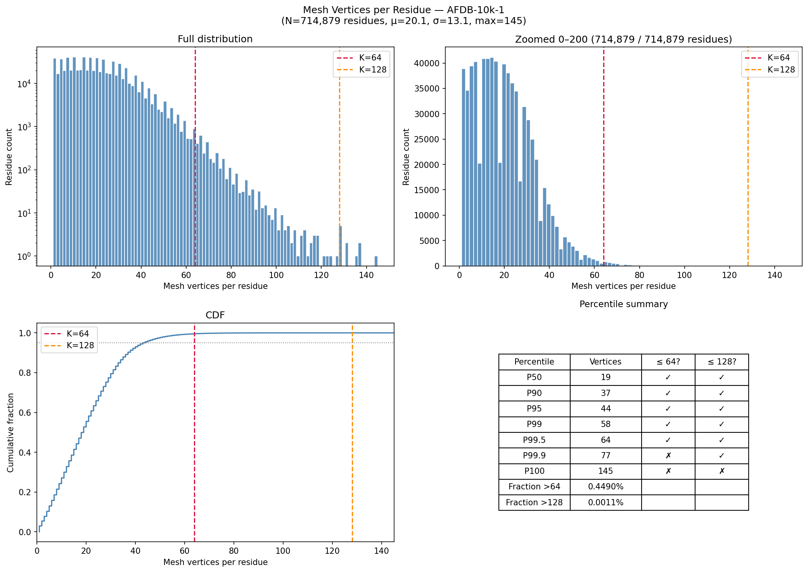
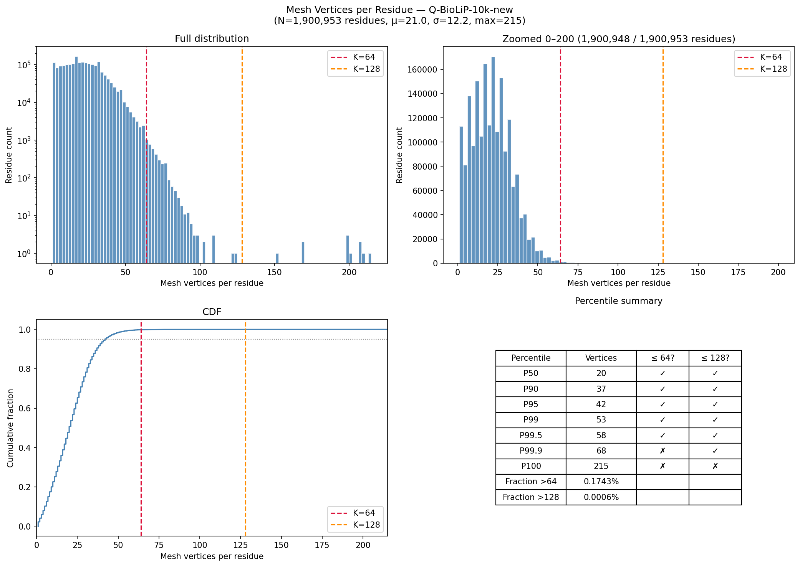
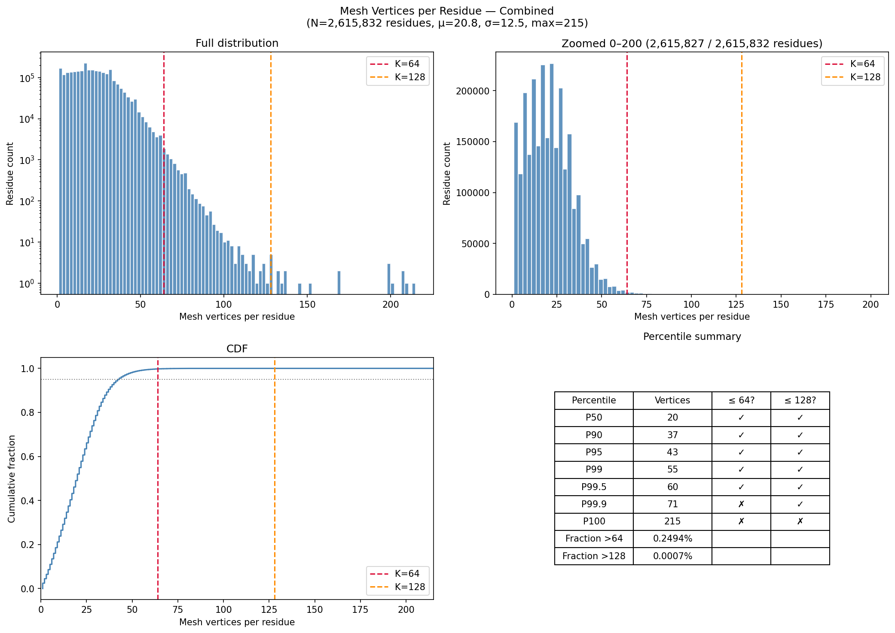

# Mesh Prior 实验

## 旧方案：`build_surface_features`（KNN + CA center）

### 代码位置

`openfold3/projects/of3_all_atom/physppi/features/_builders.py`

### 核心逻辑

```
对每个 token (残基):
  1. 确定 center 点:
     - 有 CB 原子 且 非 GLY → CB 坐标
     - 否则 → CA 坐标                    ← v3 bb_input 无 CB, 100% 走 CA
  2. 确定 local basis:
     - N/CA/C 三个 backbone 原子构建局部坐标系
  3. KNN:
     - 计算 center 到该 chain 所有 mesh 顶点的欧式距离
     - 排序取最近 K=128 个
     - 变换到 local 坐标系
  4. 输出 [N_tokens, 128, 3] coords + [N_tokens, 128, 6] attrs
```

### 问题

| # | 问题 | 说明 |
|---|---|---|
| 1 | **单点代表残基** | 用一个 CB/CA 点到所有 mesh 顶点的距离决定归属。长侧链残基（ARG/LYS）远端表面点可能被遗漏，小残基（GLY/ALA）反而抢到不相干的点 |
| 2 | **边界泄漏** | 相邻残基的 KNN 各自独立执行 → 同一个 mesh 顶点可能被多个残基同时选中，信息跨 token 泄漏 |
| 3 | **v3 数据退化** | bb_input 只有 backbone 原子（N/CA/C/O），无 CB、无侧链 → center 100% 是 CA。KNN 本质是 "距离 CA 最近的 128 个表面点"，与残基化学性质无关 |
| 4 | **无法预计算** | center 依赖 atom_array（训练时 crop 后变化），KNN 每次 `__getitem__` 重新计算 |

## 新方案：KDTree 最近重原子映射

参考 MaSIF 的做法（`/101045/jinyu/PPI/Prior/src/physppi_prior/mesh_prior.py`
`compute_point_to_residue`, line 432），用 **所有蛋白重原子构建 KDTree，每个 mesh 顶点
归属于欧式距离最近的重原子所在的残基**。

> ⚠️ **当前实现是 v3 兼容方案**。v3 的 prior PKL 中不包含顶点→残基的映射，
> 所以本目录的 `generate_mesh_tensors.py` 用 bb_input PDB 手动建 KDTree 做映射。
>
> **v4 数据已预计算此映射**：`mesh_prior.py` 的 `convert_mesh_ply_to_pkls_for_chunk_v4`
> (line 521-539) 会在 v4 PKL 中写入额外 key：
>
> ```python
> # v4 prior PKL 格式
> {
>     case_id: {chain_id: [[x,y,z,charge,hbond,hphob,nx,ny,nz,si], ...]},
>     f"{case_id}_point_to_residue": {
>         chain_id: [residue_idx, ...],  # 长度 = 该 chain 的 vertex 数量
>         ...                             # 每个元素是该顶点归属的残基编号
>     },
> }
> ```
>
> `compute_point_to_residue()` (line 441-475) 用 KDTree(全部重原子).query(k=1) 生成此映射，
> 与 `generate_mesh_tensors.py` 的逻辑等价。切换到 v4 后直接读此 key 即可，无需重新跑 KDTree。
>
> 📝 **TODO (v4 适配)**：
> - [ ] 从 v4 PKL 的 `{case_id}_point_to_residue` 直接读取映射
> - [ ] KDTree 改用全链**全部重原子**（v4 bb_input 包含完整 backbone + sidechain）
> - [ ] 重新跑分布分析（预期每残基顶点数大幅下降，全集中在 64 以下）

### 特点

- **单点单残基**：每个 mesh 顶点只分配给 1 个残基，交界区域就近划分，不记录多残基共享
- **结果可预计算**：生成 `[N, K, 9]` 的固定形状 tensor，存为 `.pt` 文件，训练时直接
  `torch.load()` 加载，跳过 `build_surface_features` 的全部计算

### 数据维度

原始 mesh 顶点：`[point, 10]` = xyz(3) + charge(1) + hbond(1) + hphob(1) + normal(3) + si(1)

输出：`[N, K, 9]` = xyz(3) + charge(1) + hphob(1) + normal(3) + si(1)
> 去掉 hbond 列，与当前 PhysPPI 代码（`_builders.py` line 342-343）一致

### 大于 K 的点如何处理

按每个顶点到其最近重原子的欧式距离**升序排列**，取前 K 个（最靠近残基内部原子的顶点优先）。
距离在 KDTree 查询时已经计算了，不增加额外开销。

### K 值选择实验（2000 样本/数据集，使用 bb_input PDB 建 KDTree）

| 数据集 | 采样数 | 残基数 | μ | σ | max | >64 | >128 |
|---|---|---|---|---|---|---|---|
| AFDB-10k-1 | 2000 | 714,879 | 20.1 | 13.1 | 145 | 0.45% | 0.001% |
| Q-BioLiP-10k-new | 2000 | 1,900,953 | 21.0 | 12.2 | 215 | 0.17% | 0.001% |
| Combined | 4000 | 2,615,832 | 20.8 | 12.4 | 215 | 0.25% | 0.001% |

- **K=64**：覆盖 99.7% 残基
- **K=128**：覆盖 99.998%

建议 K=64，在覆盖率和内存间取得平衡。

> ⚠️ **TODO**: 当前分析基于 **v3 数据**（mesh 仅 interface residues，KDTree 用 `bb_input`
> PDB 建树，重原子仅含 interface 区域）。v3 中 mesh 点集中在 interface 残基上，
> 导致部分残基顶点数偏多（max=215）。
>
> **v4 切换到全链 mesh 后需要重新分析**：
> 1. KDTree 改为对整个 chain 的 **全部重原子** 建树（不是只 interface）
> 2. mesh 点分散到全链所有残基上 → 每个残基的顶点数预计会**大幅下降**
> 3. 预期几乎所有残基都能落在 K=64 以内，不再需要截断

### 分布图





## 与现有方案对比

| | 旧方案 (`build_surface_features`) | 新方案 (KDTree 映射) |
|---|---|---|
| 顶点→残基 | CA 到 mesh 顶点距离 → KNN 取 128 | 全部重原子建 cKDTree → 每顶点找最近原子 → 归属该原子残基 |
| center | CB 优先, 缺则 CA（v3 bb_input 无 CB → 100% CA） | 不需要 center, 用全部重原子坐标 |
| 共享 | 边界顶点可能被多个残基同时选中 | 单点单残基, KDTree 查询 k=1 |
| 输出形状 | `[N, 128, 3]` + `[N, 128, 6]` | `[N, K, 9]` |
| 可预计算 | 否（center 依赖 atom_array, crop 后变化） | 是（映射关系固定，存 `.pt`） |
| K 值 | 固定 128 | 64（50% 内存减小，99.7% 残基无需截断） |

## 文件

| 文件 | 说明 |
|---|---|
| `mesh_residue_mapping.py` | KDTree 映射 + 分布统计 + 绘图 |
| `generate_mesh_tensors.py` | 预计算脚本：prior_pkl + bb_input + seq_cache → `{case_id}_mesh.pt` |
| `mesh_adapter.py` | 训练时 adapter：`torch.load(.pt)` → `[N_tokens, K, 3/6]` + mask |
| `distribution_*.png` | 每残基 mesh 顶点数分布图 |
| `report_*.json` | 逐样本详细统计 |

## 预计算输出

### 绝对路径

```
/101045/jinyu/PPI/Prior_out/precomputed_mesh/cli_v3/
  AFDB-10k-1/
    chunk0001/ ... chunk0050/
      {case_id}_mesh.pt          (每个 sample 一个 .pt, ~850KB)
      ...
    generation_summary.json
  Q-BioLiP-10k-new/
    chunk0001/ ... chunk0050/
      {case_id}_mesh.pt
      ...
    generation_summary.json
```

### 真实样例 1：AFDB homodimer（无 gap）

**`.pt` 内容**：
```
file:  AF-0000000065979461-model_v1_mesh.pt  (850,829 bytes)
keys:  ["data", "resseq"]

chain A:  data.shape = [184, 64, 9]      resseq = [1,2,...,184]  (len=184, 与 data 行数一致)
          82/184 残基有 mesh (v3: 44.6% interface)
          verts/res: min=1, max=56, mean=22.3
```

**对应的原始数据**：

| 类型 | 绝对路径 |
|---|---|
| GT PDB | `/101045/jinyu/PPI/Prior_out/training/AFDB-10k-1/chunk/chunk0008/gt/AF-0000000065979461-model_v1.pdb` |
| bb_input | `/101045/jinyu/PPI/Prior_out/training/AFDB-10k-1/chunk/chunk0008/bb_input/AF-0000000065979461-model_v1_{A,B}.pdb` |
| prior_pkl | `/101045/jinyu/PPI/Prior_out/training/AFDB-10k-1/chunk/chunk0008/prior_pkl/AF-0000000065979461-model_v1.pkl` |
| 预计算 .pt | `/101045/jinyu/PPI/Prior_out/precomputed_mesh/cli_v3/AFDB-10k-1/chunk0008/AF-0000000065979461-model_v1_mesh.pt` |

### 真实样例 2：Q-BioLiP 多链 + gap（验证 N 匹配 + unresolved 处理）

`8iru_1` (chunk0045) 是一个 5 链复合物，chain A/C/E 均有大量 unresolved residues。
chain E 最极端：430 residues 中 162 个 unresolved（37.7%）。

**`.pt` 内容**（chain A，gap 最典型的链）：
```
file: 8iru_1_mesh.pt

chain A:  data.shape = [356, 64, 9]    resseq len = 356  (与 seq_cache full_seq 一致)
          N = 356 = seq_cache len(full_seq_1aa) ✅
          assigned (有 mesh): 183
          non-interface (有原子无 mesh): 48
          unresolved (resseq=-1): 125  (rows 231-355)

gap 边界验证 (chain A):
  data_row=48,  pdb_resseq=54,  ARG,  2 verts  (有 mesh)
  data_row=49,  pdb_resseq=55,  ILE,  0 verts  (gap 前最后一个残基, non-interface)
  data_row=50,  pdb_resseq=181, TYR,  44 verts (gap 后第一个, 跳过 56→180, 125 个残基)

chain C:  unres=15  (rows 231-245)
chain E:  unres=162 (rows 268-429), N=430
```

**对应的原始数据**：

| 类型 | 绝对路径 |
|---|---|
| GT PDB | `/101045/jinyu/PPI/Prior_out/training/Q-BioLiP-10k-new/chunk/chunk0045/gt/8iru_1.pdb` |
| bb_input | `/101045/jinyu/PPI/Prior_out/training/Q-BioLiP-10k-new/chunk/chunk0045/bb_input/8iru_1_{A,B,C,D,E}.pdb` |
| prior_pkl | `/101045/jinyu/PPI/Prior_out/training/Q-BioLiP-10k-new/chunk/chunk0045/prior_pkl/8iru_1.pkl` |
| 预计算 .pt | `/101045/jinyu/PPI/Prior_out/precomputed_mesh/cli_v3/Q-BioLiP-10k-new/chunk0045/8iru_1_mesh.pt` |

### 生成命令

```bash
# AFDB
python3 experiments/mesh_prior/generate_mesh_tensors.py \
    --dataset-dir /101045/jinyu/PPI/Prior_out/training/AFDB-10k-1 \
    --output-dir /101045/jinyu/PPI/Prior_out/precomputed_mesh/cli_v3/AFDB-10k-1 \
    --k 64

# Q-BioLiP
python3 experiments/mesh_prior/generate_mesh_tensors.py \
    --dataset-dir /101045/jinyu/PPI/Prior_out/training/Q-BioLiP-10k-new \
    --output-dir /101045/jinyu/PPI/Prior_out/precomputed_mesh/cli_v3/Q-BioLiP-10k-new \
    --k 64
```

### 生成逻辑

```
输入:
  chunk/prior_pkl/{case_id}.pkl    → mesh 顶点 (monomer-local 坐标, v3 仅 interface)
  chunk/bb_input/{case_id}_{ch}.pdb → per-chain monomer PDB (MSMS 源文件, 同坐标系)
  chunk/seq_cache.pkl              → full_seq_1aa → 每链总残基数 N
  chunk/gt/{case_id}.pdb           → 残基排列顺序 (与 token_index 一致)

流程:
  1. load_mesh_vertices(pkl)        → {chain_id: [[10 floats], ...]}
  2. parse_gt_residues(bb_input)    → 每链重原子坐标 + resseq (monomer-local)
  3. cKDTree(重原子).query(顶点)     → 每个顶点归属最近重原子残基
  4. 按距离排序, 取前 K=64
  5. 从 seq_cache 获取 N, 从 GT PDB 获取残基排列
  6. 构建 tensor[N, K, 9]: 按 GT PDB 残基顺序排列
     - interface 残基: 填入最近 K 个顶点
     - 非 interface 残基: 全零 (v3 只有 interface 有 mesh)

输出: {case_id}_mesh.pt
```

### `.pt` 文件格式

```python
{
    "data": {
        chain_id: torch.Tensor[N, 64, 9],   # N = len(full_seq_1aa), 按 GT PDB 残基顺序
        ...
    },
    "resseq": {
        chain_id: [resseq_0, resseq_1, ...],  # 第 i 行对应的 PDB 残基编号
        ...
    },
}
```

- `data[chain]` 第 i 行 = GT PDB 中第 i 个残基的 mesh 顶点
  - interface 残基：有实际值（≥1 个顶点，最多 64）
  - 非 interface 残基：全零
- `resseq[chain]` 第 i 个元素 = 该残基的 PDB 编号（与训练时 `token_index` 的 `(chain_id, resseq)` 对应）

### 坐标系统

```
MSMS 输入: bb_input/{case_id}_{chain_id}.pdb  (per-chain monomer PDB, interface residues)
MSMS 输出: .ply 文件                          (monomer-local 坐标系)
PKL 存储: 直接从 .ply 读取                     (monomer-local 坐标系, 同 bb_input)
KDTree:   对 bb_input PDB 重原子建树           (同 monomer-local 坐标系)
           → 顶点到残基的映射在 monomer-local 下完成, 无需对齐

训练时 mesh_adapter:
  monomer-local verts  →  @rotation + translation  →  complex coords
  complex coords       →  (xyz - center) @ basis    →  per-token local frame
```

### Adapter 集成（伪代码）

```python
# __getitem__ 中替代 build_surface_features()
payload = torch.load(f"precomputed_mesh/{case_id}_mesh.pt", map_location="cpu")
mesh_data = payload["data"]       # {chain: tensor[N, 64, 9]}
mesh_resseq = payload["resseq"]   # {chain: [resseq list]}
resseq_to_idx = {ch: {r: i for i, r in enumerate(rlist)} for ch, rlist in mesh_resseq.items()}

K = 64
surface_coords = torch.zeros(N_tokens, K, 3)
surface_attrs  = torch.zeros(N_tokens, K, 6)
surface_mask   = torch.zeros(N_tokens, K, dtype=torch.bool)

for (chain_id, resseq), token_row in token_index.items():
    idx = resseq_to_idx.get(chain_id, {}).get(resseq)
    if idx is None:
        continue
    verts = mesh_data[chain_id][idx]  # [K, 9], zero rows → masked
    m = int((verts.abs().sum(dim=-1) > 0).sum().item())
    if m == 0:
        continue
    # ... 坐标变换 (monomer→complex→local) + 填入 surface_coords/attrs/mask
```

## _runtime.py 集成记录

### 修改文件

`openfold3/projects/of3_all_atom/physppi/data/adapters/_runtime.py`

### 改动内容

1. **新增 import**（第 106-114 行）：导入 `build_surface_from_precomputed` + 数据集路径映射 `_MESH_PT_DATASET_MAP`
2. **新增 helper 函数** `_build_surface_mesh_prior()`（第 118-168 行）：
   - 从 `sample.paths.prior_pkl` 推导 chunk 名和 dataset root
   - 拼出 `.pt` 路径：`{root}/precomputed_mesh/cli_v3/{dataset}/chunkXXXX/{case_id}_mesh.pt`
   - 存在 → `build_surface_from_precomputed(k=64)`
   - 不存在 → 自动回退到原 `build_surface_features(k=num_surface_neighbors)`
3. **修改 `build_prior_features()`**（原 1558-1564 行）：调用从 `build_surface_features(...)` 改为 `_build_surface_mesh_prior(...)`
4. **文件头**：新增 Jinyu Lin 修改声明

### 回退策略

当 `.pt` 不存在（screening / 新数据 / chunk 未预计算）时，**静默回退**到旧的 KNN 方法，
保证现有流程不中断。

## TODO

- [ ] **v4 数据适配**：切换为全链 mesh + 全部重原子 KDTree，重新跑分布分析
- [x] ~~Adapter 集成~~ ✅ 已完成：`_runtime.py` 已修改，`build_prior_features` 使用预计算 mesh
- [ ] 修改 `SurfaceTokenEncoder` 输入适配 `[B, N, K, 3+6]`（K 从 128 → 64）
- [ ] `generate_mesh_tensors.py` 中 KDTree 改为对整个 chain 全部重原子建树（目前仅 bb_input 重原子）
